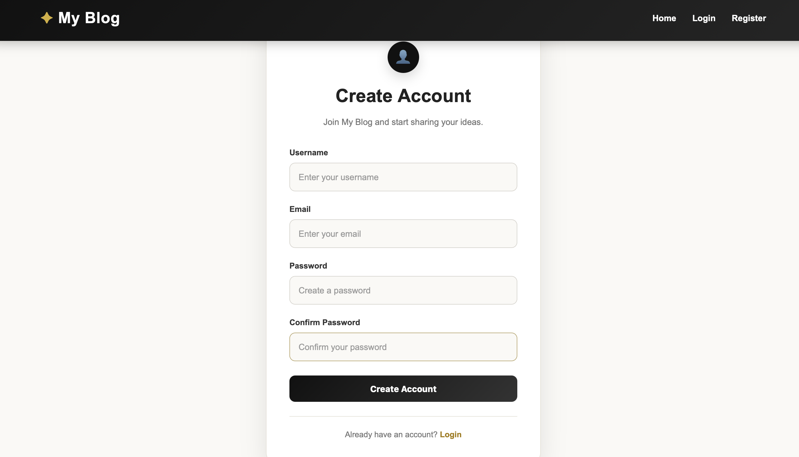
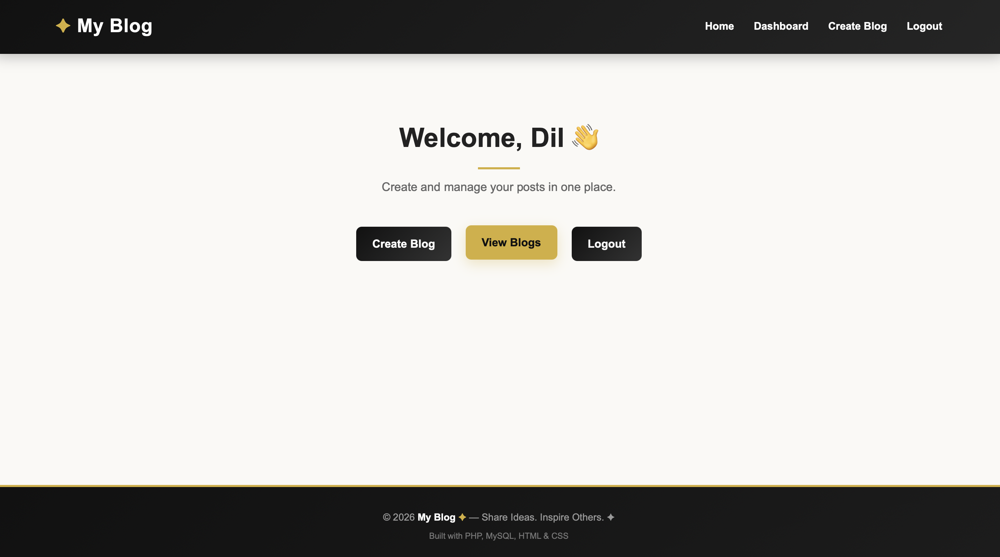

# 📝 PHP Blog Application

A dynamic and user-friendly blog application developed using PHP and MySQL. This project allows users to create accounts, manage their blog posts, and share content through a simple web interface.

## 📌 Project Overview

The PHP Blog Application is designed to provide a platform where users can register, log in, and manage their own blog posts.

The application includes user authentication, blog post management, and a dashboard for managing content.

## ✨ Features

- 👤 User Registration
- 🔐 User Login and Logout
- 📝 Create New Blog Posts
- ✏️ Edit Existing Blog Posts
- 🗑️ Delete Blog Posts
- 📚 View Published Blog Posts
- 📊 User Dashboard
- 🎨 User-Friendly Interface

## 🛠️ Technologies Used

| Technology | Purpose |
|---|---|
| PHP | Backend Development |
| MySQL | Database Management |
| HTML5 | Page Structure |
| CSS3 | Styling and Layout |
| JavaScript | Frontend Interactions |
| XAMPP | Local Development Environment |

## 📂 Project Structure

```text
Blog-Application/
│
├── assets/
├── includes/
│
├── blog.php
├── create_blog.php
├── dashboard.php
├── delete_blog.php
├── edit_blog.php
├── index.php
├── login.php
├── logout.php
├── register.php
│
├── .gitignore
└── README.md
```

## ⚙️ Installation and Setup

### 1. Clone the Repository

```bash
git clone https://github.com/dilnawo/Blog-Application.git
```

### 2. Move the Project

Move the cloned project folder into the XAMPP `htdocs` directory.

### 3. Start XAMPP

Start the following services:

- Apache
- MySQL

### 4. Create the Database

1. Open phpMyAdmin.
2. Create a MySQL database.
3. Import the project's SQL database file, if included in the repository.

### 5. Configure Database Connection

Open the database configuration file inside the `includes/` folder.

Update the database connection settings with your local MySQL credentials and database name.

### 6. Run the Application

Open your browser and visit:

```text
http://localhost/Blog-Application/
```

## 🎯 Learning Outcomes

Through this project, I gained practical experience in:

- PHP server-side development
- MySQL database integration
- User authentication
- CRUD operations
- Frontend and backend integration
- Building dynamic web applications

## 👩‍💻 Developer

**Dilki Nawodya**

IT Undergraduate  
University of Moratuwa, Sri Lanka

[GitHub](https://github.com/dilnawo) | [LinkedIn](https://www.linkedin.com/in/dilki-nawodya-7b645358/)

---

⭐ If you find this project interesting, feel free to explore the repository!
---

## 🖥️ Website Screenshots

### 🏠 Home Page


### 📝 Registration Page


### 👤 User Dashboard


### 📚 View Blogs


### ✍️ Create Blog

